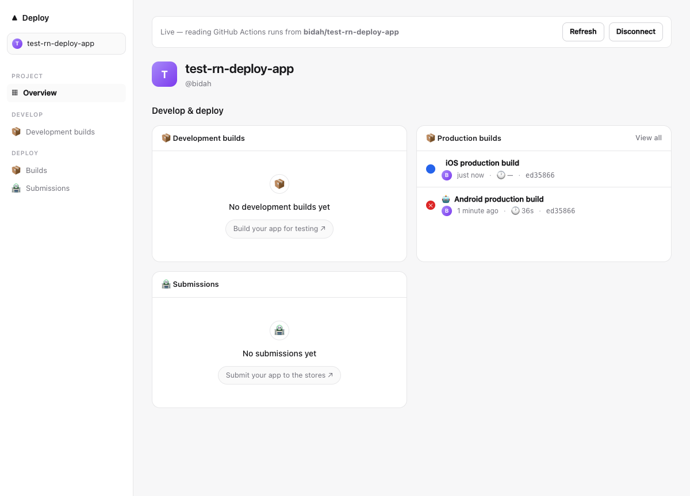
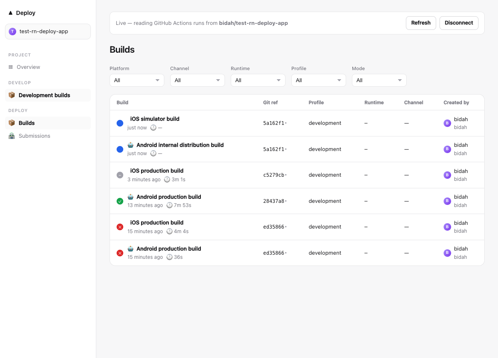
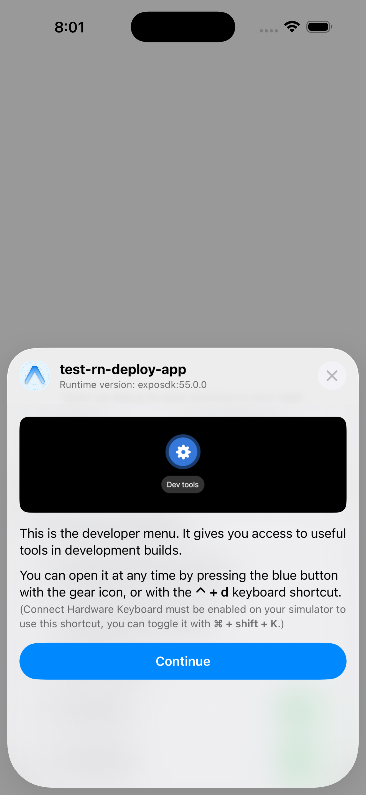
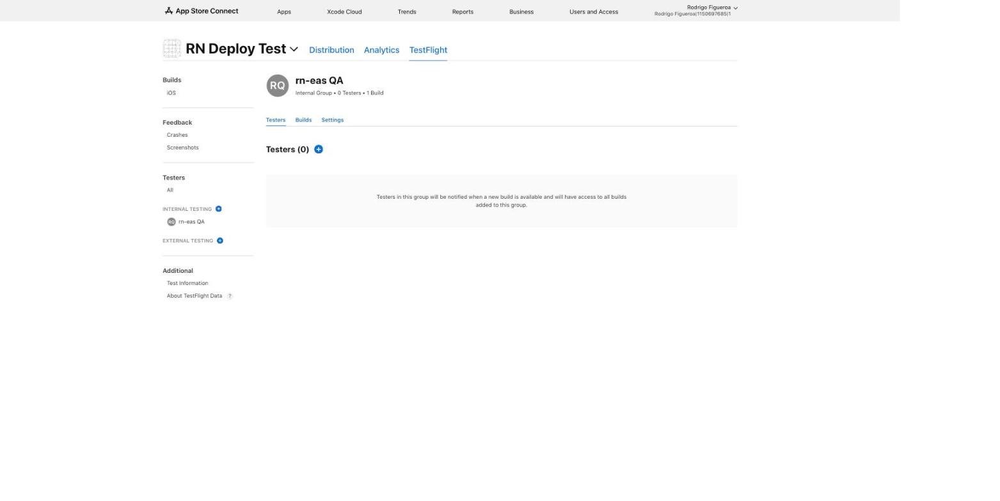
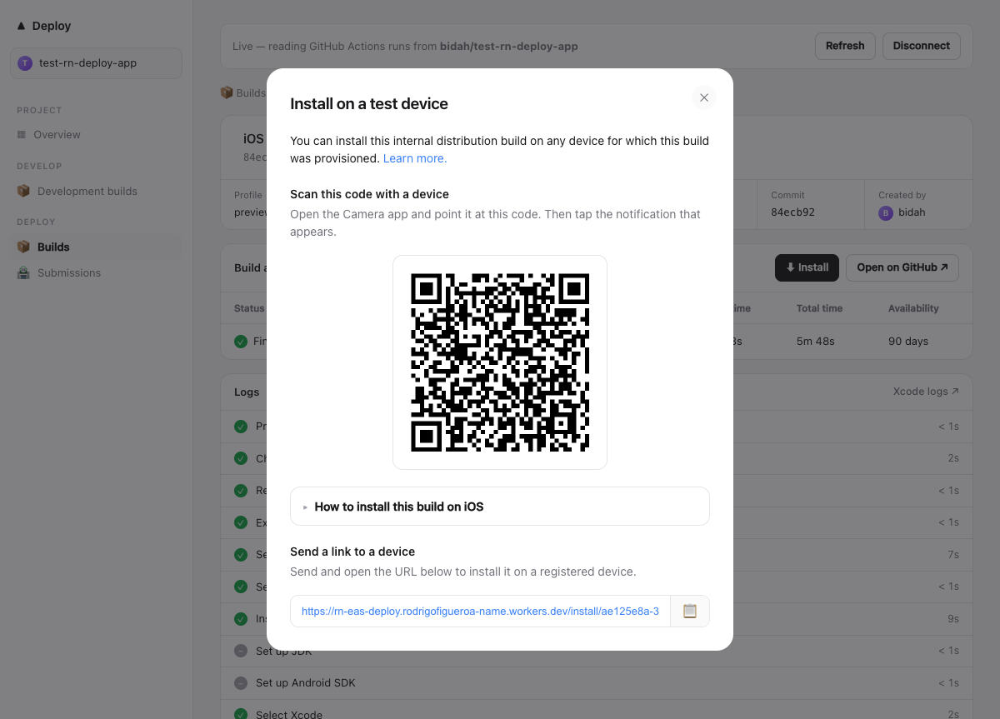
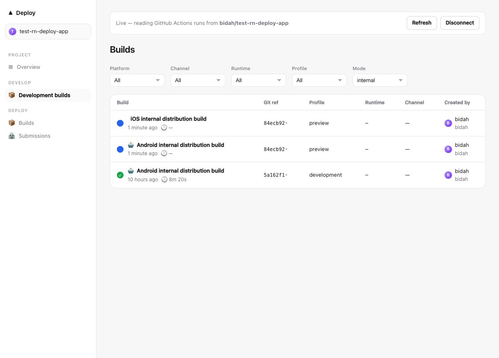

# rn-eas release test — end-to-end user flow

**Date:** 2026-09-30 · **Tester:** Claude Code (driving the CLI and dashboard as a new user)
**Library under test:** `eas/` (rn-eas 0.1.0) + `web/` dashboard, from `feat/gh-build-github-actions`
**Test app:** [`bidah/test-rn-deploy-app`](https://github.com/bidah/test-rn-deploy-app) — blank Expo SDK 55 / RN 0.83.2 app (`~/Programing/test-rn-deploy-app`)

## Verdict

**All four flows now work end to end** — a blank Expo app went from a local folder to a signed build
in a TestFlight group with only `eas` commands plus one-time Apple setup. **But not on the code
as it was:** the live run hit 8 bugs that I fixed — 5 of them (B2, B4, B5, B7, B11) made builds fail or
report success falsely — and none were caught by the existing test suite. They are fixed in the working tree (see *Changes*);
3 high-severity gaps remain open (B1, B10, B12). **Recommendation: don't release until B12 is
fixed and B1 at least has a clear error** — B12 breaks the second TestFlight upload of every app.

| # | Flow | Result |
|---|---|---|
| 1 | Publish the app as a **public** GitHub repo (free macOS minutes) | ✅ Pass — with a manual workaround for B1 (still open) |
| 2 | **Development preview**: build in the cloud, watch status in the local dashboard, download, run on simulator, live-reload | ✅ Pass — after 7 fixes (B2–B7, B9) |
| 3 | **Provisioning keys**: distribution cert + App Store profile into repo secrets | ⚠️ Pass — **manual**; the CLI has no way to add credentials |
| 4 | **TestFlight**: signed production build → `eas submit` with the ASC API key | ✅ Pass — after fix B11 |
| 5 | **QR install of preview builds** on a registered device (EAS internal distribution) | 🟡 Built, verified up to the phone — awaiting a scan on a physical iPhone |
| 6 | **Hosted dashboard** on Cloudflare (Vite app + install pages) | ✅ Pass — https://rn-eas-deploy.rodrigofigueroa-name.workers.dev |
| 7 | **CLI docs site** | ✅ Live — https://rn-eas-deploy.rodrigofigueroa-name.workers.dev/deploy/docs/ |

The CLI's own suite went from 548 → **555 passing tests** (7 new regression tests, 1 corrected expectation); the dashboard's from 29 → **38**.
Every bug below that was fixed was found by the live run, not by the existing suite — the suite
proves `eas.json` compatibility thoroughly but never executes the generated workflow.

---

## The persona

> A React Native developer with an Expo app and no Mac build server. They want to (1) put the app
> on GitHub so builds are free, (2) get a development build running against their local Metro
> with a dashboard showing build status, (3) add their Apple signing assets, and (4) push a
> signed build to TestFlight using an App Store Connect API key.

Environment: macOS (Darwin 25.4), Node 24.18, `gh` logged in as `bidah` (scopes `repo, workflow`),
`asc` 1.2.8 with a keychain-stored ASC API key, Xcode simulator iPhone 17 Pro Max (iOS 26.4).

> ⚠️ `eas` on the PATH is Expo's real `eas-cli@24.6`, not this package. All commands below ran
> `node eas/bin/eas.js` (aliased `rneas`). Anyone following the README's `npm link` will shadow —
> or be shadowed by — a global `eas-cli`. Worth a note in the install section.

---

## Flow 1 — Public GitHub repo

```bash
EAS_GITHUB_TOKEN=$(gh auth token) eas login      # ✔ Logged in as bidah
eas build:configure                               # ✔ eas.json + .github/workflows/eas-build.yml
gh repo create bidah/test-rn-deploy-app --public --source . --push
eas credentials                                   # ✔ detects bidah/test-rn-deploy-app
```

| Step | Result |
|---|---|
| `eas login` via `EAS_GITHUB_TOKEN` | ✅ token verified, stored 0600 |
| `eas build:configure` | ✅ files written — but see B8 (no bundle id / package) |
| repo public, Actions enabled | ✅ |
| **first `eas build`** | ❌ `GitHub API POST …/eas-build.yml/dispatches failed (404): Not Found` |

**B1 — First build after creating the repo 404s (blocker for every new user).**
GitHub does not register a `workflow_dispatch`-only workflow that arrives in the push that *creates*
the repository. Verified by bisection: an empty follow-up commit did not register it; a trivial
`on: push` probe registered instantly; touching `eas-build.yml` in a normal push registered it
immediately. The CLI surfaces only `(404): Not Found`.
*Not fixed.* Suggested fix: on a 404 from the dispatch endpoint, check `GET /actions/workflows` and,
if `eas-build.yml` is missing, say *"GitHub hasn't registered the workflow — commit any change to
.github/workflows/eas-build.yml and push"*. `build:configure` could also print this for new repos.

**Public-repo caveat for the README:** on a public repo, workflow artifacts (the `.ipa`/`.apk`) are
downloadable by any signed-in GitHub user for the 90-day retention. Repo secrets stay private.

---

## Flow 2 — Development preview

```bash
# as a user would: dev-client dependency, and a simulator dev profile
npx expo install expo-dev-client
# eas.json → build.development.ios.simulator = true
eas build -p all -e development --no-wait
eas build:list
eas build:download -p ios   &&  eas build:download -p android
xcrun simctl install booted testrndeployapp.app
npx expo start --dev-client
```

### What the user sees in the dashboard

`cd web && npm run dev` → `http://localhost:5177/deploy/dashboard/` → *Connect a repository* →
`bidah/test-rn-deploy-app` + token. Live status of every run, with correct titles after fix B3:


*Before fix B3: dev builds mislabelled "production build" and filed under Production builds.*


*After fix B3: "iOS simulator build" / "Android internal distribution build" in progress; the older rows were dispatched before the fix.*

### Running the downloaded build

| Check | Result |
|---|---|
| Android dev build → `app-debug.apk` (151 MB) | ✅ run `36769011109` |
| iOS simulator build → `testrndeployapp.app` (165 MB, `com.bidah.testrndeployapp`) | ✅ run `36770375318` on `macos-26` |
| `simctl install` + deep link into the dev client | ✅ |
| JS bundle served by local Metro | ✅ `iOS Bundled 4147ms index.js (698 modules)` |
| Fast Refresh: edit `App.js` → UI updates | ✅ within 2 s |




### Bugs found in this flow (all fixed, see "Changes")

**B2 — Android builds always failed at "Set up Android SDK".** `android-actions/setup-android@v3`
installs the legacy `tools` package, which cmdline-tools 16.0 on today's `ubuntu-latest` no longer
has (`Warning: Failed to find package 'tools'`, exit 1, 36 s in). → bumped to `@v4` (defaults to
`platform-tools`).

**B3 — Every build was labelled "production build"; distribution filters matched nothing.**
The workflow `run-name` stamped only `platform` and `profile`; the mapper reads `distribution` and
`simulator` from it and fell through to STORE. Beyond the wrong titles (CLI *and* dashboard), the
Overview's "Development builds" card stayed empty and `eas submit --latest`'s
`distribution: 'store'` filter could never match correctly. → `run-name` now stamps
`distribution` and `simulator` via `fromJSON(inputs.config_json)`.

**B4 — iOS builds of any managed Expo project failed: `'ios/.xcworkspace' does not exist`.**
The plan sent `scheme: profile.scheme ?? appConfig.scheme ?? ''`. Nothing knows the Xcode scheme
before prebuild runs, and `appConfig.scheme` is Expo's **deep-link URL scheme**, not an Xcode
scheme — an app with `"scheme": "myapp"` would have archived a nonexistent workspace. → new
*Resolve Xcode scheme* step after `pod install` (profile `scheme` wins, else the single
`ios/*.xcworkspace`, with a clear error if there are 0 or several); `appConfig.scheme` fallback removed.

**B5 — Failed iOS builds reported ✅ success and shipped an empty `.app`.** `xcodebuild … | xcpretty
|| true` discarded the exit code and the simulator path never checked its output: run
`36769022323` went green with a 146-byte tarball containing an empty bundle. For users this is the
worst class of bug — a green build that doesn't work. → both `xcodebuild` steps now read
`${PIPESTATUS[0]}` and fail with a pointer to the `xcode-logs` artifact; the simulator step also
asserts the `.app` has an `Info.plist`. B7 below was caught *because* of this fix.

**B6 — `eas build:download` without `--build-id` always said "no application archive … may have
expired".** It took the newest build from `listBuilds()`, which only reads runs, never artifacts, so
`applicationArchiveUrl` was always null. → re-fetch the full record via `getBuildByRunId`. The
post-download hint also said "unzip it to get the .aab" for an APK; it now uses the build's own
distribution.

**B7 — iOS builds on the default runner can't compile Expo SDK 55.** `macos-15` defaults to Xcode
16.4; `expo-modules-core` uses Swift 6.2 syntax (`extension UIView: @MainActor AnyArgument` →
`unknown attribute 'MainActor'`). → iOS resource classes now map to `macos-26` /
`macos-26-xlarge` (default Xcode 26.6). README table updated.

**B9 — `developmentClient: true` profiles were built as Release.** EAS documents that
`developmentClient` "is for setting the gradleCommand to `:app:assembleDebug` for Android and
buildConfiguration to `Debug` for iOS"; this port produced `app-release.apk`. → both defaults
applied (an explicit `gradleCommand` / `buildConfiguration` still wins). The existing test that
asserted `assembleRelease` for a dev-client profile was encoding the bug and was corrected.

---

## Flow 3 — Provisioning keys

**B10 — There is no way to add credentials with the CLI.** `eas credentials` only *reports* which
of `EAS_IOS_DIST_P12` / `EAS_IOS_P12_PASSWORD` / `EAS_IOS_PROFILE` exist and points at
`asc signing`, but `asc signing fetch` returns the certificate *without* its private key and never
touches GitHub secrets. A user has to assemble this themselves. What worked, keychain-free:

```bash
asc bundle-ids create --identifier com.bidah.testrndeployapp --name "RN Deploy Test" --platform IOS
openssl genrsa -out dist.key 2048
openssl req -new -key dist.key -out dist.csr -subj "/CN=rn-eas/C=US"
asc certificates create --certificate-type IOS_DISTRIBUTION --csr dist.csr      # → 3QW9FZ7559
openssl x509 -inform DER -in dist.cer -out dist.pem
openssl pkcs12 -export -inkey dist.key -in dist.pem -out dist.p12 -passout file:p12pass \
  -certpbe PBE-SHA1-3DES -keypbe PBE-SHA1-3DES -macalg sha1                      # see note
asc profiles create --bundle <bundleIdResource> --certificate 3QW9FZ7559 \
  --profile-type IOS_APP_STORE --name "RN Deploy Test AppStore"                  # → MDM8G8ZXGZ
base64 -i dist.p12 | gh secret set EAS_IOS_DIST_P12
gh secret set EAS_IOS_P12_PASSWORD < p12pass
base64 -i appstore.mobileprovision | gh secret set EAS_IOS_PROFILE
eas credentials -p ios        # ✔ ✔ ✔
```

Lessons that belong in a future `eas credentials` wizard:
- **Don't export from the login keychain.** `security export -t identities` exports *every*
  identity and macOS prompts once per private key (6 prompts here), each asking for the login
  keychain password, which users often don't know. Generating a fresh key + CSR needs no prompts.
- **Use legacy PKCS#12 encryption.** OpenSSL 3's default AES `.p12` is rejected by macOS
  `security import` on the runner; 3DES/SHA-1 works.
- The App Store Connect **app record** can't be created by API; it was created through the ASC
  web UI ("RN Deploy Test", app id `6817907751`). The wizard should detect a missing record and
  say so up front rather than failing at submit.

**B11 — Signed archives failed: `"testrndeployapp" requires a provisioning profile`.** The workflow
imported the p12 and profile but never told Xcode to use them — `CODE_SIGN_STYLE=Manual` with no
team, profile or identity, and an `ExportOptions.plist` without `provisioningProfiles`. A freshly
prebuilt Expo project has no signing settings of its own. → the import step now reads UUID, team
and bundle id from the decoded profile and the identity SHA-1 from the temp keychain; a new
*Apply signing settings* step sets manual signing on **only the target that builds that bundle id**
(a global `PROVISIONING_PROFILE_SPECIFIER` breaks Pods resource bundles); export options carry
`teamID`, `signingCertificate` and the profile map; cleanup removes the profile by UUID.
Limitation: one profile, so app extensions (widgets, notification services) are not signed yet.

---

## Flow 4 — TestFlight

```bash
# eas.json → submit.production.ios = { ascAppId: "6817907751", groups: ["rn-eas QA"] }
asc testflight groups create --app 6817907751 --name "rn-eas QA" --internal
eas build -p ios -e production --no-wait             # run 36789190773, 5m 54s on macos-26
eas build:download -p ios && unzip …                 # testrndeployapp.ipa, 8.5 MB
eas submit -p ios --profile production --path build/testrndeployapp.ipa \
  --what-to-test "rn-eas release test 2026-09-30: …"
eas submit:status -p ios --profile production
```

| Check | Result |
|---|---|
| First production build | ❌ `requires a provisioning profile` → **B11** (Flow 3), fixed |
| Rebuild | ✅ `Manual signing applied to 2 build configuration(s)` · `** EXPORT SUCCEEDED **` |
| IPA signature | ✅ `Authority=iPhone Distribution: Rodrigo Figueroa (388JA947H4)`, profile "RN Deploy Test AppStore", 1.0.0 (1) |
| `eas submit` (ASC API key from `asc`'s keychain) | ✅ uploaded, processed, grouped in **2 m 43 s** |
| Build state in App Store Connect | ✅ `1 VALID` (`asc builds list`, `eas submit:status`) |
| "What to Test" note | ✅ `betaBuildLocalizations` en-US carries the text |
| TestFlight group | ✅ "rn-eas QA · Internal Group · 0 Testers · **1 Build**" |
| `eas submit` without `--path` | ✅ finds the latest *store* build (only possible after B3) and prints the download steps |



To get it on a phone: add yourself to *rn-eas QA* (internal testers must be App Store Connect
users) and install from the TestFlight app.

UX note (B17, low): `eas submit` with no `--path` stops and prints two commands; it already knows
the build id and could download and unzip the IPA itself.

---

## Flow 5 — QR install of preview builds (added 2026-10-01)

**Before:** the Install modal's QR encoded the dashboard's own build page; on a phone that page
asked for a GitHub token and had no install action. Nothing produced an `itms-services` link or a
publicly downloadable binary — GitHub artifacts are zips behind a login. The workflow also had a
single `EAS_IOS_PROFILE`, so an internal build was signed with the App Store profile (or failed),
never an ad-hoc one listing test devices. The QR was decorative.

**Now** (new code, see *Changes*):

```
eas build -e preview ─► runner: sign with EAS_IOS_PROFILE_INTERNAL (ad-hoc, test devices)
                     ─► "Publish for install": multipart upload → Worker → R2 builds/<dispatchId>/
                        app.ipa|app.apk, then meta.json (page appears only when the binary is complete)
dashboard Install ─► QR → https://<worker>/install/<dispatchId>   (random UUID: not guessable)
iPhone ─► page shows "Install" = itms-services://…manifest.plist ─► manifest ─► app.ipa
Android ─► page shows "Download APK"
```

Setup a user does once:

```bash
asc profiles create --bundle <bundleIdRes> --certificate <distCert> --device <deviceId> \
  --profile-type IOS_APP_ADHOC --name "RN Deploy Test AdHoc"                   # → 784577S665
base64 -i adhoc.mobileprovision | gh secret set EAS_IOS_PROFILE_INTERNAL
gh secret set EAS_INSTALL_TOKEN < upload_token         # same value as the Worker's UPLOAD_TOKEN
gh variable set EAS_INSTALL_URL --body https://rn-eas-deploy.rodrigofigueroa-name.workers.dev
eas credentials                                        # ✔ EAS_IOS_PROFILE_INTERNAL, ✔ EAS_INSTALL_TOKEN
```

| Check | Result |
|---|---|
| iOS preview build (run `36823072864`) | ✅ signed with profile `291e87c0…` (ad-hoc), `** EXPORT SUCCEEDED **`, published |
| Android preview build (run `36823064404`) | ✅ `BUILD SUCCESSFUL`, published (61 MB APK) |
| Install page, iPhone user agent | ✅ app name, 1.0.0 (1), profile, size, commit; **Install** → `itms-services://?action=download-manifest&url=…` |
| `manifest.plist` | ✅ `plutil -lint` OK; points at the HTTPS IPA, `com.bidah.testrndeployapp` |
| Served IPA | ✅ `codesign --verify --deep --strict`; embedded profile "RN Deploy Test AdHoc" with exactly 1 device (Iphone roro) |
| Install page, Android user agent | ✅ **Download APK** → `application/vnd.android.package-archive`, `content-disposition: attachment` |
| Dashboard → Install → QR | ✅ QR decodes (CoreImage) to `…/install/ae125e8a-3455-4bfa-a8dd-34cab74f7cd1` |
| Worker guards | ✅ upload without token 401 · key outside `builds/<uuid>/(meta.json\|app.ipa\|app.apk)` 400 · unknown build 404 page |
| Multipart round trip (7 MiB, 2 parts) | ✅ bytes identical after download |
| Physical iPhone, 1st attempt (build `ae125e8a…`) | ❌ *"No se pudo instalar… no fue posible verificar su integridad"* — see B18 |
| Physical iPhone, 2nd attempt (build `942f390b…`, profile `38F5TK7KBQ` = the iPhone 16) | 🟡 **pending** — awaiting the scan |



**B18 — The first install failed because the profile held the wrong phone, and nothing said so.**
iOS reports a device missing from an ad-hoc profile only as *"integrity could not be verified"*.
The device chosen, "Iphone roro", is an **iPhone 7** (40-hex legacy UDID, registered 2022); the
phone in hand is an **iPhone 16** also named "Iphone roro" on-device, registered in App Store
Connect as "iOS Device (added by Expo)" (`3KXB754D94`, `00008140-000024A414C1801C`). Confirmed
with `xcrun devicectl device info details`. Fix: ad-hoc profile regenerated for `3KXB754D94`,
secret updated, rebuilt. Tooling changes: `eas device:list` now prints the **model** next to each
name (would have shown "iPhone 7" immediately). Still worth doing: list the provisioned devices
(name + model) on the install page, so a tester sees "this build is for: iPhone 16" before tapping.

Caveats to put in the README:
- Only devices in the ad-hoc profile can install; adding a device means regenerating the profile,
  updating the secret, and **rebuilding**. `eas device:create` still only prints an `asc` command.
- iOS 16+: Developer Mode must be on for internal builds (the install page says so).
- Install pages are public to anyone holding the link (unguessable UUID, not authenticated), and
  R2 objects never expire — add a lifecycle rule if 90-day parity with artifacts matters.
- Android release builds are still signed with the debug key until an `EAS_ANDROID_KEYSTORE` is
  set; fine for sideloading, not for Play.

## Flow 6 — Hosted dashboard on Cloudflare (added 2026-10-01)

**Before:** `reactnativefeel.com/deploy/dashboard/` returned 404 and the repo had no Cloudflare
configuration; the dashboard only ran under `npm run dev`.

**Now:** `web/wrangler.jsonc` + `web/worker/` — one Worker (`rn-eas-deploy`) serves the Vite build
from Workers static assets under `/deploy/dashboard/`, the install pages, and the upload API, with
an R2 binding (`rn-eas-builds`). `npm run deploy` in `web/` builds and publishes.

| Check | Result |
|---|---|
| `/` → `/deploy/dashboard/` | ✅ 302 |
| Hard refresh on a client route (`/deploy/dashboard/builds/<id>`) | ✅ 200 (SPA fallback) — first version 307'd, see below |
| Missing hashed asset | ✅ stays 404 (no HTML served for `.js`) |
| Connect `bidah/test-rn-deploy-app` **without a token** | ✅ live runs (B14 fixed) |
| Sidebar highlight on *Development builds* | ✅ only that item (B16 fixed) |



Found while deploying: the SPA fallback first fetched `/deploy/dashboard/index.html` from the
assets binding, which Workers' default `html_handling` answers with a 307 to the directory —
bouncing deep links. It now fetches the directory URL.

---

## Flow 7 — CLI docs site (added 2026-10-01)

`docs-site/` — VitePress 1.6.4, base `/deploy/docs/`, served by the same Worker (`npm run deploy`
in `web/` builds the dashboard and the docs, then deploys). 13 pages: getting started, how it
works, differences from EAS, building, eas.json, development builds, internal distribution,
credentials, submitting, dashboard & install service, troubleshooting, and two references.

**The command reference is generated** (`scripts/gen-commands.mjs`) from `eas/src/cli/spec.js` —
the table the contract tests hold against `eas-cli`'s manifest — so it cannot drift from the CLI.
Each command pairs `eas-cli`'s description with an **In rn-eas** note, and flags the handler
ignores carry an *"accepted, no effect yet"* badge.

Verified: build passes VitePress's dead-link check; every `#anchor` cross-link resolves in the
built HTML (9/9); live routes 200, `/deploy/docs` → 301, unknown page → 404 with the VitePress
404 body; *Dashboard* nav link leaves the docs (`target="_self"`); local search index contains the
page text. Two Workers-assets quirks fixed on the way (both: fetch the extensionless path, since
`html_handling` redirects `*.html`).

Writing the docs against the code surfaced:

**B19 — `eas build --auto-submit` is accepted but silently ignored**, as are
`--auto-submit-with-profile`, `--what-to-test`, `--build-logger-level`, `--freeze-credentials`,
`--refresh-ad-hoc-provisioning-profile` and `--verbose-logs`: `src/commands/build.js` never reads
them. The README listed `--auto-submit` as supported; corrected. Also: `validateBuildable`'s
"no credentials configured" checks never fire, because `eas build` doesn't pass credentials in.

---

## Open issues (not fixed)

| ID | Severity | Issue |
|---|---|---|
| B1 | **High** | First dispatch on a new repo 404s with no guidance (see Flow 1) |
| B10 | **High** | No credential setup command; the manual path above is the only way |
| B12 | **High** | `autoIncrement: true` is sent as `auto_increment` but the workflow never reads it — every build has build number 1, so the **second** TestFlight upload of a version is rejected |
| B19 | Medium | `--auto-submit` (and 6 more `build` flags) accepted but ignored — documented with a badge; implement or reject |
| B8 | Medium | `build:configure` writes no `ios.bundleIdentifier` / `android.package` (EAS prompts for both); a managed prebuild on the runner then has nothing to sign |
| B11-ext | Medium | App extensions need their own profiles; only the main target is signed |
| B13 | Low | `eas login` prints "no SSO or browser flow" even when neither flag was passed (`options.browser` defaults to `true`) |
| B17 | Low | `eas submit` without `--path` could download the latest store build instead of printing instructions |
| — | Info | `build:configure`'s default `development` profile uses `developmentClient: true` but doesn't add `expo-dev-client`; the user must install it |
| — | Info | The workflow's Android copy step triggers shellcheck SC2038 (`find | xargs` without `-print0`) |

---

## Changes made to the library

`eas/` is untracked on this branch, so these don't show in `git diff`:

| File | Change |
|---|---|
| `eas/templates/eas-build.yml` | B2 `setup-android@v4` · B3 `run-name` stamps distribution/simulator · B4 *Resolve Xcode scheme* step · B5 `PIPESTATUS` checks + `.app` assertion · B7 `macos-26` default · B11 profile/identity outputs, *Apply signing settings* step, export options, UUID cleanup |
| `eas/src/build/plan.js` | B4 drop `appConfig.scheme` · B7 `macos-26` runners · B9 dev-client → `assembleDebug` / `Debug` |
| `eas/src/commands/build.js` | B6 re-fetch latest build before download; artifact-type hint |
| `eas/README.md` | B7 runner table |
| `eas/test/build/plan.test.js` | runner labels; dev-client expectation corrected; URL-scheme regression test |
| `eas/test/build/workflow-contract.test.js` | 6 new contract tests: run-name fields, scheme resolution, no swallowed `xcodebuild` failures, signing wiring, ad-hoc profile selection, install publishing order |
| `eas/templates/eas-build.yml` (Flow 5) | `EAS_IOS_PROFILE_INTERNAL` for `export_method: ad-hoc`; *Publish for install* step (multipart upload, meta last, step-summary link) |
| `eas/src/build/plan.js` (Flow 5) | sends `app_name`, `android_package` |
| `eas/src/models/build.js` | `_dispatchId` on the Build record (keys the install URL) |
| `eas/src/commands/misc.js` | `eas credentials` reports `EAS_IOS_PROFILE_INTERNAL` and `EAS_INSTALL_TOKEN`; `eas device:list` shows the model (B18) |
| `web/worker/index.js`, `web/worker/install.js` (new) | the Worker: dashboard assets + SPA fallback, install page, OTA manifest, R2 streaming, token-guarded multipart upload |
| `web/worker/install.test.js` (new) | 9 tests: key validation, manifest escaping, itms URL encoding, per-device page, XSS escaping, UA detection |
| `web/wrangler.jsonc` (new), `web/package.json`, `web/.gitignore` | Worker config (assets + R2), `build:worker` / `deploy` scripts, `wrangler@4.145.0` dev dependency |
| `web/src/pages/BuildDetail.jsx` | QR/link → install page for internal builds; APK vs AAB label |
| `web/src/components/InstallModal.jsx` | doc comment now matches behaviour |
| `web/src/api/store.jsx`, `web/src/api/github.js`, `web/src/App.jsx`, `web/src/pages/Builds.jsx` | B14 token optional + rate-limit message · B15 loading state · B16 query-aware nav highlight |

`npm test` in `eas/`: **555 / 555 pass** · `web/`: **38 / 38 pass** · `actionlint`: clean apart from SC2038.

## Resources created during the test

| Where | What |
|---|---|
| GitHub | public repo `bidah/test-rn-deploy-app` + 3 `EAS_IOS_*` secrets |
| Apple Developer | bundle id `com.bidah.testrndeployapp` (`B4ZA7LF68K`), iOS Distribution cert `3QW9FZ7559` (key only in the scratch dir + repo secret), App Store profile `MDM8G8ZXGZ` |
| App Store Connect | app "RN Deploy Test" `6817907751` (SKU `rn-deploy-test`), internal TestFlight group "rn-eas QA" |
| Apple Developer (Flow 5) | ad-hoc profile `38F5TK7KBQ` "RN Deploy Test AdHoc" (device: iPhone 16 `3KXB754D94`); the first one, `784577S665` (iPhone 7), was deleted |
| Cloudflare | Worker `rn-eas-deploy` (workers.dev) with secret `UPLOAD_TOKEN`; R2 bucket `rn-eas-builds` |
| GitHub (Flow 5) | secrets `EAS_IOS_PROFILE_INTERNAL`, `EAS_INSTALL_TOKEN`; variable `EAS_INSTALL_URL` |

Revoke cert `3QW9FZ7559` and delete the repo when the test app is no longer needed.
